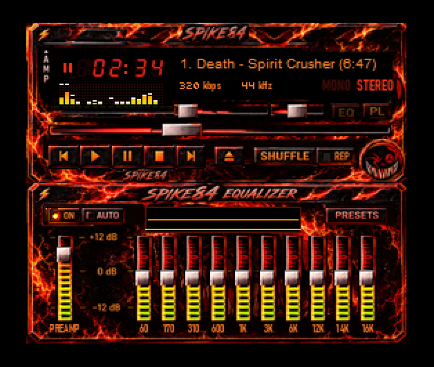

# Winamp skin "Spike84"

La mia skin personale per Winamp. Mi chiamo Spike84.

Lo stile è fuoco e lava, con il logo SPIKE84 e il teschio. Ci sono la finestra principale, l'equalizzatore e la playlist.

## Installazione

1. Scarica [`Spike84.wsz`](Spike84.wsz).
2. Copialo nella cartella `Skins` di Winamp, di solito `C:\Program Files (x86)\Winamp\Skins`.
3. In Winamp apri Opzioni → Skin e scegli **Spike84**.

È una skin classica, quindi funziona anche su WACUP e su Webamp.
